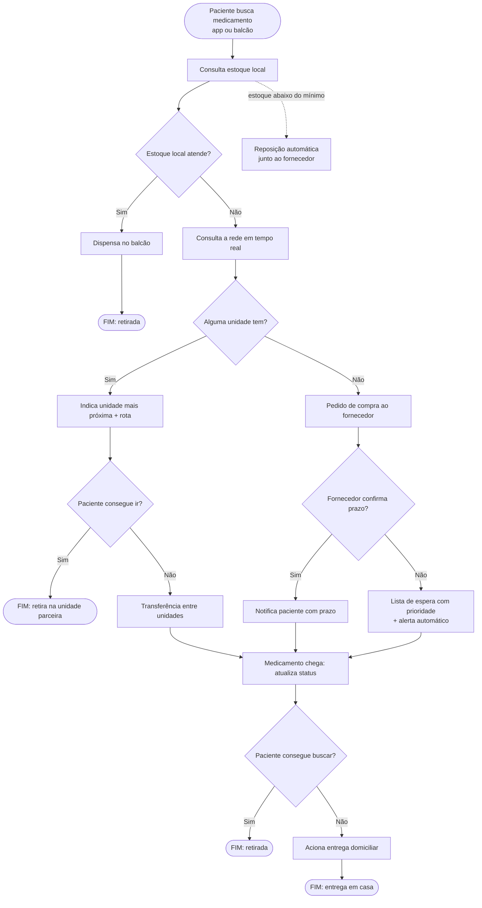

# Visão do Projeto — Localização, Reposição e Entrega de Medicamentos

> Projeto Integrador I · Análise e Desenvolvimento de Sistemas (Noturno) · FATEC Taquaritinga · 2026
> Orientador: Prof. Gabriel Passatuto Gallo
> Grupo: Arthur Vinicius Ferreira, Bruno Henrique Jacinto, Lorena Duarte Malaguti, Paulo Henrique de Souza Santos

Documentos relacionados: [[02 - Proposta de Valor]] · [[03 - Validação da Ideia]]

---

## 1. Em uma frase

Um sistema que mostra **onde há um medicamento essencial disponível agora**, leva o paciente até a unidade mais próxima e, quando não há estoque em lugar nenhum, **cuida da espera e da entrega** para que o tratamento não seja interrompido.

## 2. O problema

Hoje o paciente só descobre que o medicamento está em falta **quando chega ao balcão**. Não existe uma forma simples de consultar antes onde o item está disponível na rede pública (UBS e farmácias municipais) e na rede credenciada ao **Programa Farmácia Popular do Brasil (PFPB)**.

Isso tem três consequências:

1. **Peregrinação**: o paciente visita várias unidades, o que é especialmente difícil para idosos, pessoas com mobilidade reduzida e quem mora longe.
2. **Interrupção do tratamento**: sem o medicamento, o paciente raciona doses ou para de tomar, com risco clínico comprovado (piora, internação, AVC, morte em doenças cardiovasculares).
3. **Desperdício na rede**: uma unidade fica sem o item enquanto outra tem sobra, e o problema é resolvido com nova compra quando bastaria remanejar.

## 3. A solução proposta

Uma ferramenta de **consulta e roteamento de estoque** com quatro etapas:

| Etapa | O que acontece |
|---|---|
| **1. Entrada** | O paciente procura o medicamento pelo aplicativo ou no balcão da unidade. |
| **2. Triagem local** | O sistema consulta o estoque da unidade. Se houver, o medicamento é dispensado. Se o estoque cair abaixo do mínimo, a reposição é disparada automaticamente, em paralelo. |
| **3. Resolução em rede** | Se faltar no local, o sistema consulta as demais unidades, indica a mais próxima e calcula a rota. Se o paciente não puder ir, pede a transferência para uma unidade acessível. Se não houver em lugar nenhum, registra o pedido ao fornecedor. |
| **4. Retirada ou entrega** | O paciente é avisado quando o medicamento chega. Retira na unidade ou recebe em casa (motoboy, parceiro logístico ou Correios). |

Quando o fornecedor não confirma prazo, o paciente entra numa **lista de espera com alerta automático**, com **prioridade para pacientes crônicos, oncológicos e com doenças raras**.

### Fluxo principal

## 4. Quem usa

| Ator | Papel no sistema |
|---|---|
| **Paciente** | Busca o medicamento, recebe notificações, escolhe entre retirar ou receber em casa. |
| **Farmacêutico / unidade** | Consulta o estoque, dispensa, registra pedidos ao fornecedor. |
| **Unidade parceira** | Recebe e atende pedidos de transferência. |
| **Fornecedor** | Confirma ou não o prazo de entrega da reposição. |
| **Logística / entrega** | Motoboy, parceiro logístico, Correios ou programa municipal de entrega. |

**Interessados (stakeholders):** Secretarias Municipais de Saúde e gestores do SUS (menos desperdício, abastecimento garantido), Ministério da Saúde, farmácias credenciadas ao PFPB.

## 5. Escopo

**O sistema faz:**

- RF01: consultar o estoque local de um medicamento;
- RF02: consultar a disponibilidade na rede de unidades parceiras;
- RF03: indicar a unidade mais próxima com o item e calcular a rota;
- RF04: registrar pedido de compra ao fornecedor quando não há estoque na rede;
- RF05: notificar o paciente sobre prazo de reposição ou chegada;
- RF06: inscrever o paciente em lista de espera com alerta automático e prioridade clínica;
- RF07: solicitar e gerenciar transferência entre unidades;
- RF08: acionar entrega no domicílio quando o paciente não pode retirar.

**O sistema não faz:**

- não resolve a causa-raiz do desabastecimento (orçamento e planejamento de compras pelos entes públicos);
- não substitui prescrição médica nem faz avaliação clínica;
- não vende medicamentos (diferente de marketplaces como o Consulta Remédios);
- não cobre farmácias privadas fora da rede credenciada.

**Requisitos não funcionais:** resposta da consulta em menos de 10 s (meta interna sugerida: menos de 2 s); disponibilidade de 99% em horário de atendimento; conformidade com a LGPD para dados de saúde (dados sensíveis); escalabilidade para outras redes municipais e estaduais.

## 6. Próximos passos

1. Ajustar o escopo da rede com base na [[03 - Validação da Ideia]] (seção "Ajustes recomendados").
2. Detalhar os requisitos não funcionais (SLA, disponibilidade, LGPD).
3. Prototipar as telas e construir a prova de conceito (POC) e o produto mínimo viável (MVP).
4. Estudar um programa de entrega voluntária para pessoas com mobilidade reduzida.
5. Módulo futuro: **acompanhamento da adesão ao tratamento** (lembretes, previsão de quando o medicamento vai acabar).
