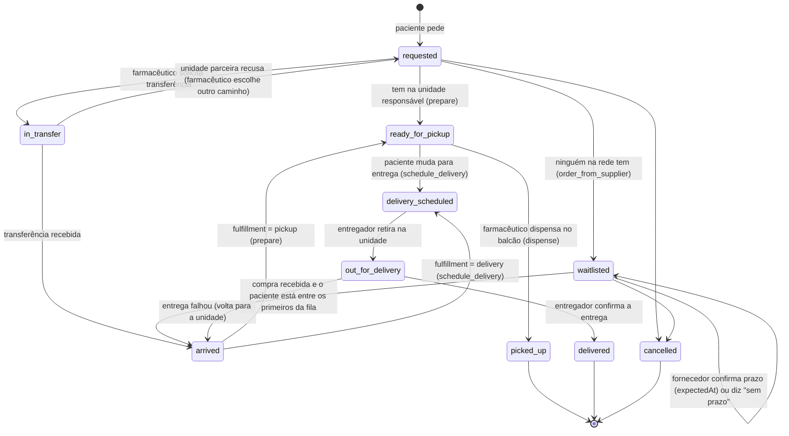

# Design do backend — demonstração "Dona Maria"

- **Implementado em:** 2026-11-03 (ver [registro da implementação](2026-11-03-backend.md))
- **Última alteração:** —
- **Requisitos:** RF01–RF08, RNF01, RNF03

## Em poucas palavras

O backend vai ser o "balcão invisível" que conecta a Dona Maria ao farmacêutico: ela pergunta pelo app onde tem o remédio, ele responde e conduz o pedido, e o sistema anota tudo — estoque, transferência, fila, entrega e avisos — num banco de verdade (PostgreSQL). Para a banca, a história é contada em três cenas, cada uma provando um pedaço do fluxo do PI.

## O que

Uma API (Fastify 5 + TypeScript, em `apps/backend`) com login, banco PostgreSQL e as regras do fluxo principal do PI, suficiente para uma demonstração ao vivo em que **cada ator do fluxo do PI usa o próprio login e faz só o seu papel**: paciente, profissionais das farmácias (unidade responsável e unidade parceira), fornecedor, entregador do programa municipal e, no fechamento, o gestor. Ninguém simula o papel de outro.

## Por que

- A dor do projeto: o paciente só descobre a falta do remédio no balcão; sem o remédio, interrompe o tratamento (ver `contexto/01 - Visão do Projeto.md`).
- A validação da ideia (`contexto/03 - Validação da Ideia.md`) recomendou mostrar o **ciclo completo com prioridade clínica** como diferencial, e não "consulta em tempo real" (que já existe em SP).
- A apresentação vai usar o PostgreSQL da VPS do grupo, então os dados já precisam ser persistentes, com login e perfis.

## A história da demonstração

Personagem: **Dona Maria**, 72 anos, hipertensa, usa losartana todo dia e tem dificuldade para andar. Mora em Taquaritinga; a unidade de referência dela é a **UBS Centro**.

| Cena                         | O que acontece                                                                                                                                                                                                                                                                                                                                                                                                                                                                                                                                                 | Requisitos                            |
| ---------------------------- | -------------------------------------------------------------------------------------------------------------------------------------------------------------------------------------------------------------------------------------------------------------------------------------------------------------------------------------------------------------------------------------------------------------------------------------------------------------------------------------------------------------------------------------------------------------- | ------------------------------------- |
| **1. Antes de sair de casa** | Maria busca "losartana". A UBS Centro está sem. O sistema mostra que a **UBS Jardim São Sebastião**, a ~1,2 km, tem — com "atualizado há 2 h", distância e link de rota. Farmácias do Farmácia Popular aparecem como alternativa **só de consulta**.                                                                                                                                                                                                                                                                                                           | RF01, RF02, RF03                      |
| **2. Não consigo ir até lá** | Maria faz o pedido marcando "receber em casa". O **farmacêutico da UBS Centro** vê o pedido chegar, confere a receita de losartana e **solicita a transferência** à UBS Jardim São Sebastião. O **farmacêutico da Jardim São Sebastião** vê a solicitação e envia o remédio. O farmacêutico da UBS Centro confirma o recebimento e agenda a entrega. O **entregador do programa municipal** vê a entrega na lista dele, retira na UBS e confirma a entrega na casa da Maria. Maria acompanha cada mudança e recebe avisos.                                     | RF07, RF08, RF05                      |
| **3. Ninguém tem**           | Maria precisa de **adalimumabe** (alto custo), em falta em toda a rede. Como é alto custo, o pedido vai para a **farmácia de medicamentos especializados** (estadual). O **farmacêutico de lá** registra o **pedido de compra** e Maria entra na **lista de espera com prioridade** (crônica, com consentimento dado no cadastro). O **fornecedor**, no login dele, confirma o prazo e depois envia o lote (com nota fiscal, lote e validade). O farmacêutico confirma o recebimento; o remédio vai para os primeiros da fila e Maria é avisada em cada passo. | RF04, RF05, RF06                      |
| **Fechamento**               | O gestor abre o painel de **demanda não atendida**: quantas buscas da semana não encontraram o remédio na rede municipal, por medicamento.                                                                                                                                                                                                                                                                                                                                                                                                                     | valor ao gestor (validação, ajuste 7) |

**Cada um faz só o seu papel.** Fornecedor e entregador têm login próprio; a unidade parceira atende a transferência pelo login do farmacêutico de lá. Na apresentação, cada integrante do grupo pode operar um ou dois perfis em janelas separadas.

## Metas, não-metas e anti-metas

**Metas**

- As três cenas e o fechamento funcionam de ponta a ponta contra o PostgreSQL.
- A demonstração sempre começa do mesmo ponto (script de dados de exemplo que zera e recarrega).
- O frontend consegue mostrar as mudanças "ao vivo" consultando a API a cada poucos segundos.
- Contratos (tipos de request/response) exportados para o frontend espelhar.

**Não-metas (fora desta etapa)**

- Integrações reais: BNAFAR/Hórus, serviços de rota, SMS/push/WhatsApp, programa Remédio em Casa real.
- Transferência ou entrega envolvendo farmácias do Farmácia Popular (proibido pelas regras do programa — validação, risco 1).
- Venda, preço, upload de imagem de receita, receita digital assinada, avaliação clínica.
- Envio real para BNAFAR/RNDS e validação real de CNS/CPF/CRF (o modelo já guarda os campos, mas não integra).
- Recuperação de senha por e-mail, confirmação de e-mail.
- Telas (o frontend é outro trabalho; este design só define a API).

**Anti-metas (falharia mesmo "funcionando")**

- Dado pessoal ou de saúde em log, ou visível para quem não precisa (LGPD — RNF03).
- Condição clínica do paciente exposta ao gestor ou a outros pacientes.
- Fluxo do paciente com muitos passos ou dependente de entender termos técnicos (o público é idoso).
- Demonstração que depende de passos manuais no banco para funcionar.

## Decisões já tomadas

### Pelo grupo

- **Banco:** PostgreSQL; na apresentação, o da VPS (o `infra/compose.prod.yaml` já sobe um).
- **Login com perfis** diferentes para paciente e farmacêutico.
- **Cadastros:** medicamento, pedido, detalhe de entrega, paciente e farmacêutico.
- **Escopo da rede** (segue a validação): núcleo = **rede municipal do SUS** (UBS e farmácia municipal); Farmácia Popular = **somente consulta**; entrega = **programa municipal** (no lugar de motoboy/Correios). Isso resolve o item "Rede coberta" das Decisões em aberto do `CLAUDE.md`.
- **Cada ator faz só o seu papel** (2026-11-03): fornecedor e entregador têm login próprio; a unidade parceira atende a transferência pelo login dela; ninguém simula o papel de outro.
- **Modelo de dados completo** (aprovado em 2026-11-03): características reais de medicamento, lote, receita, paciente, profissional e unidade, a partir da pesquisa em fontes oficiais.
- **Tecnologia** (proposta e aprovada em 2026-11-03): Drizzle ORM com migrações versionadas; senha com argon2; sessão por token em cookie `httpOnly`; perfis paciente, profissional da farmácia (farmacêutico ou auxiliar), fornecedor, entregador e gestor; script de dados de exemplo de Taquaritinga.

### Escolhas minhas (podem ser revistas)

- **"Ao vivo" por consulta periódica** (o frontend pergunta a cada ~3 s), sem WebSocket/SSE. Mais simples e suficiente para a demonstração.
- **Token:** JWT assinado, em cookie `httpOnly`, `SameSite=Lax`, validade de 8 h. Front e API ficam na mesma origem (proxy do Vite em dev, nginx em produção), então não há cookie entre domínios. Sair = apagar o cookie.
- **Rota:** distância em linha reta (fórmula de Haversine) entre as coordenadas do paciente e da unidade + link do Google Maps com a rota. Sem serviço de mapas pago.
- **"Atualizado há X"** vem da data da última alteração do estoque de cada unidade.
- **Conta de profissional da farmácia, fornecedor, entregador e gestor** não se cria sozinha: o gestor cria (e o script de exemplo já cria as de demonstração). Paciente se cadastra sozinho.
- **Perfil `pharmacy_staff`** com ocupação farmacêutico ou auxiliar, no lugar de um perfil só de farmacêutico, para aplicar a regra de quem pode dispensar antimicrobiano e controlado.
- **Não guardar CID/diagnóstico:** só a categoria de prioridade declarada.

## Modelo de dados

Nomes seguem o glossário do `CLAUDE.md` (código em inglês). Termos novos estão marcados com ★ e entram no glossário. Os campos seguem o que os sistemas oficiais do SUS exigem (BNAFAR, RNDS, RENAME, Anvisa), para o projeto poder crescer até uma integração real; ver "Fontes" no fim.

### Pessoas e acesso

| Entidade                                     | Campos                                                                                                                                                                                                                                      | Observações                                                                                                                                                        |
| -------------------------------------------- | ------------------------------------------------------------------------------------------------------------------------------------------------------------------------------------------------------------------------------------------- | ------------------------------------------------------------------------------------------------------------------------------------------------------------------ |
| `User` ★                                     | id, role (`patient` \| `pharmacy_staff` \| `supplier_staff` \| `courier` \| `manager`), email (único), passwordHash, active, createdAt                                                                                                      | Login de todos os perfis.                                                                                                                                          |
| `Patient`                                    | userId, fullName, socialName?, birthDate, cns (Cartão Nacional de Saúde, 15 dígitos), cpf?, phone, address (rua, número, bairro, cidade, UF, CEP), latitude, longitude, referencePharmacyId, mobilityLimited (bool), notificationsConsentAt | `cns` é o identificador do SUS (RNDS aceita CNS ou CPF); `cpf` opcional. Idade é calculada da `birthDate`.                                                         |
| `PatientPriority` ★                          | patientId, category (`chronic` \| `oncology` \| `rare_disease`), declaredAt, consentAt, revokedAt?                                                                                                                                          | Dado sensível (LGPD art. 11): só existe com consentimento; retirar o consentimento preenche `revokedAt`. **Não** guardamos CID nem diagnóstico.                    |
| `Caregiver` ★ (responsável pela retirada)    | id, patientId, fullName, document (CPF ou RG), relationship, phone                                                                                                                                                                          | Quem pode retirar ou receber o remédio no lugar do paciente (como nas regras de retirada por terceiros).                                                           |
| `PharmacyStaff` ★ (profissional da farmácia) | userId, fullName, pharmacyId, occupation (`pharmacist` \| `pharmacy_assistant`), crfNumber?, crfState?                                                                                                                                      | `pharmacist` = farmacêutico (CBO 2234-05), exige CRF e UF; `pharmacy_assistant` = auxiliar de farmácia (CBO 5152-10). Substitui o `Pharmacist` da versão anterior. |

| `SupplierStaff` ★ (atendente do fornecedor) | userId, fullName, supplierId | Responde aos pedidos de compra feitos ao fornecedor dele. |
| `Courier` ★ (entregador) | userId, fullName, phone, deliveryProgram (ex.: "Remédio em Casa — Taquaritinga") | Entregador do programa municipal; vê e atualiza só as entregas atribuídas a ele. |

### Rede

| Entidade             | Campos                                                                                                                                                                                                                                     | Observações                                                                                                                                                           |
| -------------------- | ------------------------------------------------------------------------------------------------------------------------------------------------------------------------------------------------------------------------------------------ | --------------------------------------------------------------------------------------------------------------------------------------------------------------------- |
| `Pharmacy` (unidade) | id, cnes (7 dígitos)?, cnpj?, name, kind (`ubs` \| `municipal_pharmacy` \| `specialized_pharmacy` \| `pfpb`), address, latitude, longitude, phone, openingHours (texto, ex.: "seg–sex 7h–17h"), network (`municipal` \| `state` \| `pfpb`) | `specialized_pharmacy` = farmácia de medicamentos especializados (estadual, alto custo). `pfpb` = só consulta. Unidades públicas usam CNES; farmácias PFPB usam CNPJ. |
| `Supplier`           | id, name, cnpj                                                                                                                                                                                                                             |                                                                                                                                                                       |

### Medicamentos

| Entidade              | Campos                                                                                                                                                                                                                                                                                                                                                                                                                                                                                                                                                                                                                                                                   | Observações                                                                                                                                                                                                                                                                                                 |
| --------------------- | ------------------------------------------------------------------------------------------------------------------------------------------------------------------------------------------------------------------------------------------------------------------------------------------------------------------------------------------------------------------------------------------------------------------------------------------------------------------------------------------------------------------------------------------------------------------------------------------------------------------------------------------------------------------------ | ----------------------------------------------------------------------------------------------------------------------------------------------------------------------------------------------------------------------------------------------------------------------------------------------------------- |
| `Medication`          | id, activeIngredient (nome pela DCB), concentration (ex.: "50 mg"), pharmaceuticalForm (`tablet` \| `capsule` \| `oral_solution` \| `oral_suspension` \| `injectable` \| `cream` \| `inhaler` \| `other`), route (`oral` \| `subcutaneous` \| `intramuscular` \| `intravenous` \| `topical` \| `inhalation` \| `other`), dispensingUnit (ex.: "comprimido", "frasco", "caneta"), component (`basic` \| `strategic` \| `specialized`), therapeuticClass (ex.: "anti-hipertensivo"), prescriptionType (`none` \| `simple` \| `antimicrobial` \| `special_control`), storage (`room_temperature` \| `refrigerated`), inRename (bool), inFarmaciaPopular (bool), catmatCode? | Nome exibido = princípio ativo + concentração + forma ("Losartana potássica 50 mg comprimido"). `component` segue a RENAME 2024. `antimicrobial` = receita retida (RDC 471/2021); `special_control` = Portaria 344/98 (ex.: lista C1). `catmatCode` é o código do catálogo federal, para integração futura. |
| `StockItem`           | pharmacyId, medicationId, minQuantity, updatedAt                                                                                                                                                                                                                                                                                                                                                                                                                                                                                                                                                                                                                         | Resumo por unidade: a quantidade é a soma dos lotes; `updatedAt` alimenta o "atualizado há X".                                                                                                                                                                                                              |
| `StockBatch` ★ (lote) | id, pharmacyId, medicationId, batchNumber, expiryDate, quantity, manufacturerCnpj?, anvisaRegistration?, receivedAt                                                                                                                                                                                                                                                                                                                                                                                                                                                                                                                                                      | Cada entrada tem lote e validade (exigência da BNAFAR).                                                                                                                                                                                                                                                     |
| `StockMovement` ★     | id, pharmacyId, batchId, type (`entry_purchase` \| `entry_transfer` \| `exit_dispensation` \| `exit_transfer` \| `exit_loss` \| `adjustment`), quantity, relatedId?, createdAt, staffUserId                                                                                                                                                                                                                                                                                                                                                                                                                                                                              | Histórico de entradas e saídas, como no modelo da BNAFAR; base para o painel de validade e para auditoria.                                                                                                                                                                                                  |
| `StockReservation` ★  | id, batchId, requestId, quantity, createdAt                                                                                                                                                                                                                                                                                                                                                                                                                                                                                                                                                                                                                              | Remédio separado para um pedido (preparo, transferência, chegada da compra). Disponível de um lote = quantidade − reservas.                                                                                                                                                                                 |

### Atendimento

| Entidade                                   | Campos                                                                                                                                                                                                                                                                               | Observações                                                                                                                                                                                                             |
| ------------------------------------------ | ------------------------------------------------------------------------------------------------------------------------------------------------------------------------------------------------------------------------------------------------------------------------------------ | ----------------------------------------------------------------------------------------------------------------------------------------------------------------------------------------------------------------------- |
| `Prescription` ★ (receita)                 | id, patientId, medicationId, type (`simple` \| `antimicrobial` \| `special_control`), issuedAt, validUntil, prescriberName, prescriberCouncil (`CRM` \| `CRO` \| `COREN` \| outro), prescriberNumber, prescriberState, continuousUse (bool), checkedByStaffId?, checkedAt?           | Informada pelo paciente no pedido ou pelo farmacêutico no balcão; **conferida** pelo profissional antes de dispensar. `validUntil` vem de prazos configuráveis por tipo (ver regras). Sem upload de imagem nesta etapa. |
| `MedicationRequest` ★ (pedido do paciente) | id, patientId, medicationId, quantity, prescriptionId?, pharmacyId (unidade responsável), fulfillment (`pickup` \| `delivery`), status, sourcePharmacyId?, expectedAt?, createdAt, updatedAt                                                                                         | Unidade responsável: a de referência do paciente para `basic`/`strategic`; a `specialized_pharmacy` para `specialized`.                                                                                                 |
| `Transfer`                                 | id, requestId?, medicationId, batchId, quantity, fromPharmacyId, toPharmacyId, status (`requested` \| `shipped` \| `received` \| `refused`), refusalReason?, timestamps                                                                                                              | Só entre unidades da rede pública. A unidade de origem pode recusar (ex.: o estoque acabou), informando o motivo.                                                                                                       |
| `PurchaseOrder`                            | id, pharmacyId, medicationId, quantity, supplierId, status (`placed` \| `confirmed` \| `no_date` \| `shipped` \| `received`), expectedAt?, origin (`manual` \| `auto_min_stock`), invoiceNumber?, shippedBatchNumber?, shippedExpiryDate?, shippedQuantity?, shippedAt?, receivedAt? | O fornecedor informa nota fiscal, lote, validade e quantidade ao enviar; a farmácia confere e confirma o recebimento, que cria o `StockBatch`.                                                                          |
| `WaitlistEntry`                            | id, requestId, patientId, medicationId, pharmacyId, purchaseOrderId, priority (número calculado), status (`waiting` \| `served` \| `cancelled`), createdAt                                                                                                                           |                                                                                                                                                                                                                         |
| `Dispensation`                             | id, requestId, pharmacyId, medicationId, batchId, quantity, dispensedAt, staffUserId, prescriptionId?, pickedUpBy (`patient` \| `caregiver` \| `delivery`), caregiverId?, partialReason?                                                                                             | Campos do registro de dispensação da RNDS: unidade, paciente (pelo pedido), profissional, lote, validade (pelo lote), quantidade, data/hora, quem retirou e justificativa de entrega parcial.                           |
| `Delivery`                                 | id, requestId, method (`municipal_program`), courierId?, addressSnapshot, scheduledWindow (texto, ex.: "12/11 manhã"), requiresRefrigeration (bool, do medicamento), status (`scheduled` \| `out_for_delivery` \| `delivered` \| `failed`), receivedBy?, failureReason?, timestamps  | Programa municipal de entrega (tipo Remédio em Casa). `failed` = ninguém em casa ou outro problema informado pelo entregador; o pedido volta para `arrived` e a unidade reagenda.                                       |
| `Notification`                             | id, userId, requestId?, title, body, createdAt, readAt?                                                                                                                                                                                                                              | Texto sem dado clínico.                                                                                                                                                                                                 |
| `SearchEvent` ★                            | id, medicationId, pharmacyId (referência do paciente), foundInNetwork (bool), createdAt                                                                                                                                                                                              | Demanda não atendida. **Sem** id de paciente.                                                                                                                                                                           |

### Situações do pedido (`MedicationRequest.status`)

`arrived` é uma situação visível ("Seu remédio chegou na unidade"); a passagem para retirada ou entrega é uma ação do farmacêutico, não automática.

Regras:

- **Quem move:** cada ator só age no que é dele. Profissional da unidade responsável: preparar, pedir transferência, pedir compra, conferir receita, dispensar, agendar entrega, confirmar recebimentos. Profissional da unidade de origem: enviar ou recusar a transferência. Fornecedor: confirmar prazo, informar que não há prazo, enviar. Entregador: retirar, entregar, informar falha. Tentativas fora do papel ou da unidade respondem `403`. O paciente cria o pedido, escolhe retirada ou entrega (até `ready_for_pickup`) e cancela só em `requested` ou `waitlisted` (nesses dois não há transferência nem estoque separado para desfazer; cancelar em `waitlisted` tira a pessoa da fila, e a compra continua de pé para o estoque).
- **Avisos:** toda mudança de situação, e a confirmação de prazo do fornecedor, gera uma `Notification` para o paciente com texto simples ("Seu remédio chegou na UBS Centro", "Previsão de chegada: 12/11", "Saiu para entrega").
- **Baixa de estoque e `Dispensation`:** acontecem em `dispense` (retirada) ou quando o entregador confirma a entrega (`deliver`). Até lá o remédio fica **reservado** (`StockReservation`); assim, uma entrega que falha volta o pedido para `arrived` sem estorno de estoque. A `Delivery` nasce em `schedule_delivery` com situação `scheduled`; a unidade atribui um entregador do programa (ou deixa livre para qualquer entregador do programa aceitar), e as ações do entregador movem a `Delivery` **e** o pedido juntos.
- **Transferência:** `request_transfer` cria a `Transfer` e reserva a quantidade na origem (lote que vence primeiro). O profissional **da unidade de origem** vê a solicitação e faz `ship` (sai do estoque da origem) ou `refuse` (libera a reserva; o pedido volta para `requested`). O profissional **da unidade responsável** faz `receive` (entra no estoque do destino, mesmo lote e validade) e o pedido vai para `arrived`.
- **Fila e compra:** quando ninguém na rede tem, `order_from_supplier` coloca o pedido na fila (`WaitlistEntry`) e liga-o a um `PurchaseOrder` aberto daquele remédio naquela unidade — reaproveita o pedido de compra aberto se já existir, senão cria um. `PurchaseOrder` guarda a quantidade somando os pedidos da fila. O **fornecedor** vê os pedidos de compra feitos a ele: `confirm` grava `expectedAt` e avisa todos da fila; `no_date` avisa que ainda não há prazo; `ship` informa nota fiscal, lote, validade e quantidade enviada. A **farmácia** faz `receive` (confere e dá entrada no estoque) e passa para `arrived` os primeiros da fila, por prioridade, até acabar a quantidade recebida. Pedidos de compra automáticos (`auto_min_stock`) que chegarem também atendem a fila daquele remédio.
- **Reposição em paralelo:** sempre que o estoque de uma unidade ficar abaixo de `minQuantity`, nasce um `PurchaseOrder` automático (`auto_min_stock`) se não houver um aberto, sem bloquear o atendimento — fluxo do PI.
- **Prioridade da fila:** combina prioridade clínica (só com consentimento válido) e prioridade legal por idade: pacientes com 60 anos ou mais vêm antes dos demais, e com 80 ou mais antes dos de 60+ (Estatuto da Pessoa Idosa). Ordem final: clínica (oncológico/doença rara, depois crônico) → 80+ → 60+ → demais; empate por ordem de chegada.
- **Lotes:** a saída (dispensação, transferência) usa sempre o lote que **vence primeiro** e nunca um lote vencido. Toda entrada e saída gera `StockMovement`.
- **Receita:**
    - `prescriptionType = none`: não precisa de receita.
    - Demais tipos: só dispensa com receita **conferida** e dentro da validade. Prazos padrão, configuráveis: `simple` 180 dias com uso contínuo e 30 dias sem; `antimicrobial` 10 dias; `special_control` 30 dias. **Os prazos precisam ser conferidos com a norma do município** (escolha minha como ponto de partida).
    - `antimicrobial` e `special_control`: só um `pharmacy_staff` com `occupation = pharmacist` pode conferir a receita e dispensar; auxiliar recebe `403` com mensagem clara.
- **Unidade responsável:** pedidos de medicamento `specialized` vão para a `specialized_pharmacy`; os demais, para a unidade de referência do paciente. Unidades `pfpb` nunca recebem pedido, transferência ou entrega.
- **Entrega refrigerada:** se o medicamento é `refrigerated`, a `Delivery` nasce com `requiresRefrigeration = true` e o aviso ao paciente diz para guardar na geladeira.
- **Retirada por responsável:** ao dispensar, o profissional registra se quem retirou foi o paciente ou um `Caregiver` cadastrado.
- **Avisos para a equipe:** além do paciente, cada ator recebe `Notification` do que chega para ele: a farmácia (novo pedido, transferência solicitada ou enviada, resposta e envio do fornecedor, entrega concluída ou com falha), o fornecedor (novo pedido de compra) e o entregador (nova entrega disponível).
- Transições inválidas respondem `409` com mensagem clara.

## API (todas sob `/api`)

| Método e caminho                                                                                              | Quem                    | Para quê                                                                                                                                                                                                              | RF                     |
| ------------------------------------------------------------------------------------------------------------- | ----------------------- | --------------------------------------------------------------------------------------------------------------------------------------------------------------------------------------------------------------------- | ---------------------- |
| `POST /auth/register`                                                                                         | público                 | Paciente se cadastra (dados mínimos, unidade de referência). Pode **declarar** a categoria de prioridade (crônico, oncológico, doença rara) com consentimento; a declaração não é verificada nesta etapa              | —                      |
| `POST /auth/login` · `POST /auth/logout` · `GET /auth/me`                                                     | todos                   | Sessão                                                                                                                                                                                                                | —                      |
| `PATCH /me`                                                                                                   | paciente                | Editar contato/endereço, declarar ou mudar a categoria de prioridade, ou retirar o consentimento (ao retirar, `PatientPriority.revokedAt` é preenchido e a posição na fila é recalculada)                             | RF06                   |
| `GET /medications?search=`                                                                                    | logado                  | Buscar remédio por nome/princípio ativo                                                                                                                                                                               | RF01                   |
| `GET /medications/:id/availability`                                                                           | paciente                | Disponibilidade por unidade: situação (`available` \| `low` \| `out`), atualizado há, distância, link de rota, `consultationOnly` para PFPB. Ordem: unidade de referência, depois por distância. Grava `SearchEvent`. | RF01, RF02, RF03       |
| `POST /requests` · `GET /requests` · `GET /requests/:id` · `PATCH /requests/:id` (retirada↔entrega, cancelar) | paciente                | Pedido e acompanhamento                                                                                                                                                                                               | RF05, RF08             |
| `GET /pharmacy/requests`                                                                                      | profissional            | Fila de pedidos da unidade dele                                                                                                                                                                                       | —                      |
| `POST /pharmacy/requests/:id/actions`                                                                         | profissional            | Ações: `prepare`, `request_transfer` (com unidade de origem), `order_from_supplier`, `dispense`, `schedule_delivery`                                                                                                  | RF04, RF06, RF07, RF08 |
| `GET /pharmacy/transfers` · `POST /pharmacy/transfers/:id/actions`                                            | profissional            | Unidade de origem: `ship`, `refuse`; unidade responsável: `receive`                                                                                                                                                   | RF07                   |
| `GET /pharmacy/purchase-orders` · `POST /pharmacy/purchase-orders/:id/actions`                                | profissional            | Acompanhar pedidos de compra da unidade; `receive` (conferir e dar entrada)                                                                                                                                           | RF04, RF06             |
| `GET /supplier/purchase-orders` · `POST /supplier/purchase-orders/:id/actions`                                | fornecedor              | `confirm` (com prazo), `no_date`, `ship` (nota fiscal, lote, validade, quantidade)                                                                                                                                    | RF04, RF05             |
| `GET /pharmacy/deliveries`                                                                                    | profissional            | Entregas da unidade e situação                                                                                                                                                                                        | RF08                   |
| `GET /courier/deliveries` · `POST /courier/deliveries/:id/actions`                                            | entregador              | Entregas disponíveis e as dele; `accept`, `pick_up`, `deliver` (com quem recebeu), `fail` (com motivo)                                                                                                                | RF08                   |
| `GET /pharmacy/stock` · `PATCH /pharmacy/stock/:medicationId`                                                 | profissional            | Ver estoque (com lotes e validades) e ajustar mínimo                                                                                                                                                                  | RF01                   |
| `POST /pharmacy/stock/batches` · `POST /pharmacy/stock/batches/:id/adjust`                                    | profissional            | Entrada manual de lote; ajuste ou perda (ex.: vencido)                                                                                                                                                                | RF01                   |
| `POST /requests/:id/prescription` · `POST /pharmacy/prescriptions/:id/check`                                  | paciente · profissional | Paciente informa a receita no pedido; profissional confere                                                                                                                                                            | —                      |
| `GET/POST/DELETE /me/caregivers`                                                                              | paciente                | Responsáveis pela retirada                                                                                                                                                                                            | RF08                   |
| `GET /manager/expiring-stock?days=`                                                                           | gestor                  | Lotes que vencem nos próximos N dias, por unidade — candidatos a remanejar                                                                                                                                            | —                      |
| `GET/POST/PATCH /medications` (escrita)                                                                       | profissional, gestor    | Cadastro de medicamentos com todas as características do modelo                                                                                                                                                       | —                      |
| `GET /pharmacy/waitlist`                                                                                      | profissional            | Fila de espera da unidade, em ordem de prioridade (mostra categoria, não diagnóstico)                                                                                                                                 | RF06                   |
| `GET /notifications` · `POST /notifications/:id/read`                                                         | logado                  | Avisos do usuário                                                                                                                                                                                                     | RF05                   |
| `GET /manager/unmet-demand?from=&to=`                                                                         | gestor                  | Buscas sem estoque na rede, por medicamento e unidade de referência                                                                                                                                                   | —                      |
| `POST /manager/users`                                                                                         | gestor                  | Criar profissional da farmácia (farmacêutico com CRF ou auxiliar), atendente de fornecedor, entregador ou gestor                                                                                                      | —                      |
| `GET /pharmacies`                                                                                             | logado                  | Lista de unidades (para cadastro e mapa)                                                                                                                                                                              | —                      |

Entradas validadas com o `schema` do Fastify (regra do `CLAUDE.md`); erros no formato `{ message }`. Autorização por perfil em todas as rotas (`401` sem sessão, `403` perfil errado, unidade errada, fornecedor errado ou entrega de outro entregador).

## Dados de exemplo (Taquaritinga)

Script `db:seed` que **zera e recarrega** tudo, usado antes de cada ensaio e da apresentação. Em produção ele só roda com `ALLOW_DEMO_SEED=true` no `.env` (sem isso, recusa), para não apagar dados reais por engano.

- **Unidades:** UBS Centro (referência da Maria), UBS Jardim São Sebastião (~1,2 km), UBS Vila Negri, Farmácia Municipal, **Farmácia de Medicamentos Especializados** (estadual, alto custo); 2 farmácias PFPB (só consulta). CNES/CNPJ e coordenadas fictícios mas no formato certo, em Taquaritinga; horários de funcionamento.
- **Medicamentos** (com todas as características): losartana potássica 50 mg comprimido (receita simples, uso contínuo), metformina 850 mg comprimido, amoxicilina 500 mg cápsula (`antimicrobial`), insulina humana NPH 100 UI/mL (`refrigerated`), clonazepam 2 mg comprimido (`special_control`), dipirona 500 mg comprimido (sem receita), adalimumabe 40 mg injetável (`specialized`, `refrigerated`).
- **Estoque em lotes:** losartana **zerada na UBS Centro** e disponível na Jardim São Sebastião em dois lotes (o que vence antes sai primeiro); alguns lotes **vencendo em menos de 60 dias** para o painel do gestor; adalimumabe **zerado em toda a rede**; demais itens variados, alguns perto do mínimo. Datas de atualização variadas ("há 2 h", "há 1 dia").
- **Pessoas:** Dona Maria (72 anos, crônica com consentimento, CNS fictício, mobilidade reduzida, endereço perto da UBS Centro, a filha cadastrada como responsável pela retirada, receita de losartana de uso contínuo válida e receita de adalimumabe válida); na fila do adalimumabe, antes da Maria chegar: um paciente **oncológico** (fica na frente dela) e um paciente de 45 anos **sem prioridade** que entrou antes (fica atrás dela) — assim a prioridade aparece na tela; farmacêutico (com CRF) e um auxiliar de farmácia na UBS Centro; farmacêutico da Jardim São Sebastião; farmacêutico da Farmácia de Medicamentos Especializados; gestor; 2 fornecedores com CNPJ, cada um com um atendente com login; 2 entregadores do programa municipal.
- **Cena 3 termina com a Maria atendida:** o fornecedor envia na demonstração **2 unidades** de adalimumabe — uma para o paciente oncológico, uma para a Maria; o paciente sem prioridade continua na fila.
- **Histórico:** algumas `SearchEvent` da semana para o painel do gestor não começar vazio.
- Senhas de demonstração ficam no `.env.example`/README de demonstração, nunca reais.

## Segurança e LGPD (RNF03)

- Senhas com argon2; cookie `httpOnly`. O atributo `Secure` vem da variável `COOKIE_SECURE` (padrão `false`), porque hoje a VPS serve só HTTP (HTTPS é pendência do `infra/README.md`); quando houver HTTPS, liga-se `COOKIE_SECURE=true`.
- Logs sem nome, endereço, telefone, e-mail ou condição clínica (configurar o logger para não registrar corpo de requisição).
- Profissional da farmácia vê do paciente só: nome (ou nome social), CNS, idade, telefone e endereço (quando é entrega), responsáveis pela retirada e a **categoria** de prioridade na fila. Gestor vê só números agregados. CNS e CPF nunca aparecem em log nem em aviso.
- `PatientPriority` só conta com consentimento válido (`consentAt` preenchido e `revokedAt` vazio); o paciente pode retirar o consentimento pelo `PATCH /me`.

## Onde

| Caminho                                                                 | O que entra                                                                                                                                                                                                                                                                                                                                                                                                                    |
| ----------------------------------------------------------------------- | ------------------------------------------------------------------------------------------------------------------------------------------------------------------------------------------------------------------------------------------------------------------------------------------------------------------------------------------------------------------------------------------------------------------------------ |
| `apps/backend/src/db/`                                                  | Esquema Drizzle, conexão, migrações, seed                                                                                                                                                                                                                                                                                                                                                                                      |
| `apps/backend/src/routes/`                                              | Uma rota por recurso (padrão atual)                                                                                                                                                                                                                                                                                                                                                                                            |
| `apps/backend/src/services/`                                            | Regras: situações do pedido, fila, disponibilidade, estoque                                                                                                                                                                                                                                                                                                                                                                    |
| `apps/backend/src/auth/`                                                | Hash de senha, cookie, verificação de perfil                                                                                                                                                                                                                                                                                                                                                                                   |
| `apps/backend/src/env.ts` + `.env.example`                              | `DATABASE_URL`, `JWT_SECRET`, `COOKIE_SECURE`, `ALLOW_DEMO_SEED`                                                                                                                                                                                                                                                                                                                                                               |
| `infra/compose.prod.yaml`, `infra/.env.prod.example`, `infra/README.md` | Novas variáveis do backend. **Migrações rodam quando o backend inicia** (o migrador do Drizzle roda em tempo de execução, com as migrações SQL copiadas para a imagem — não precisa de ferramenta de desenvolvimento na VPS). O seed de produção é compilado na imagem e roda por `docker compose exec backend node dist/db/seed.js`, por uma pessoa do grupo (agentes não acessam a VPS); o README de infra documenta o passo |
| `CLAUDE.md` / `AGENTS.md`                                               | Glossário (★ e `Pharmacist` → `PharmacyStaff`), entrega = programa municipal, decisões em aberto resolvidas                                                                                                                                                                                                                                                                                                                    |

## Deixado para quem implementar

- Estrutura interna de pastas além da tabela acima, nomes de funções e tabelas.
- Biblioteca de tipagem dos schemas (ex.: TypeBox) — desde que a validação continue via `schema` do Fastify.
- Ferramenta e forma dos testes automatizados (sugestão: Vitest com banco de teste no Docker), cobrindo pelo menos situações do pedido, prioridade da fila, disponibilidade e permissões por perfil.
- Paginação e filtros extras nas listagens.

## Fontes

- BNAFAR — campos de estoque, entradas, saídas e dispensação (Anexo XXXV): [CONASS](https://www.conass.org.br/?p=19578)
- RNDS — registro de dispensação (Portaria GM/MS 6.100/2024): [CONASS](https://www.conass.org.br/?p=46165) · [Mattos Filho](https://www.mattosfilho.com.br/unico/saude-modelos-medicamentos/)
- RENAME 2024 e componentes: [Ministério da Saúde](https://www.gov.br/saude/pt-br/composicao/sectics/rename)
- Receita retida de antimicrobianos e controlados (RDC 471/2021, Portaria 344/98): [CRF-SP](https://crfsp.org.br/images/2023/OrientacaoFarmaceutica/Parte_2/Dispensao_Administrao_de_medicamentos_sujeitos__reteno_de_prescrio_sem_receita.pdf)
- Quem pode dispensar em UBS: [ICTQ](https://ictq.com.br/farmacia-clinica/2131-antimicrobianos-e-medicamentos-de-controle-especial-so-podem-ser-dispensados-em-ubs-por-farmaceuticos) · [CFF](https://site.cff.org.br/noticia/noticias-do-cff/06/08/2026/cff-reforca-em-parecer-que-dispensacao-de-medicamentos-e-atribuicao-privativa-do-farmaceutico)
- Retirada no Farmácia Popular (documentos, terceiros): [gov.br](https://www.gov.br/saude/farmaciapopular)
- Contexto do projeto: `contexto/01 - Visão do Projeto.md`, `02 - Proposta de Valor.md`, `03 - Validação da Ideia.md`

## Histórico de alterações

| Data       | O que mudou                                                                                                                                                                                                |
| ---------- | ---------------------------------------------------------------------------------------------------------------------------------------------------------------------------------------------------------- |
| 2026-11-03 | Versão inicial (design aprovado para implementação)                                                                                                                                                        |
| 2026-11-03 | Modelo de dados completo a partir da pesquisa: lotes e validade, receita, CNS, responsável pela retirada, profissional (farmacêutico/auxiliar), farmácia de especializados, prioridade por idade           |
| 2026-11-03 | Revisão: fila ligada ao pedido de compra, entrega agendada antes de sair, cancelamento só antes de haver estoque reservado, cookie `Secure` configurável, migração ao iniciar e seed protegido em produção |
| 2026-11-03 | Sem simulação: fornecedor e entregador ganham login e perfil; a unidade de origem envia ou recusa a transferência; entrega pode falhar; avisos para todos os atores                                        |
| 2026-11-03 | Implementação: reservas de estoque (`StockReservation`) e baixa do estoque da entrega só na entrega concluída                                                                                              |
